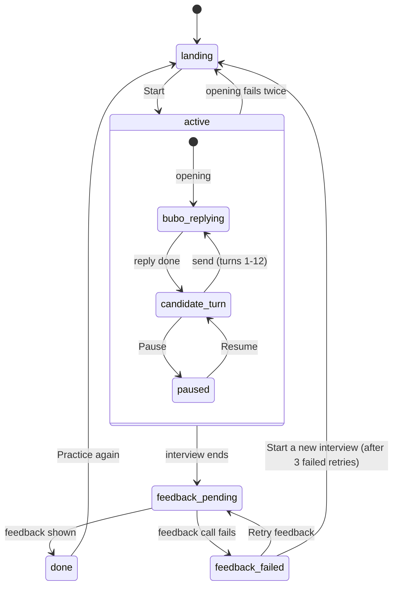
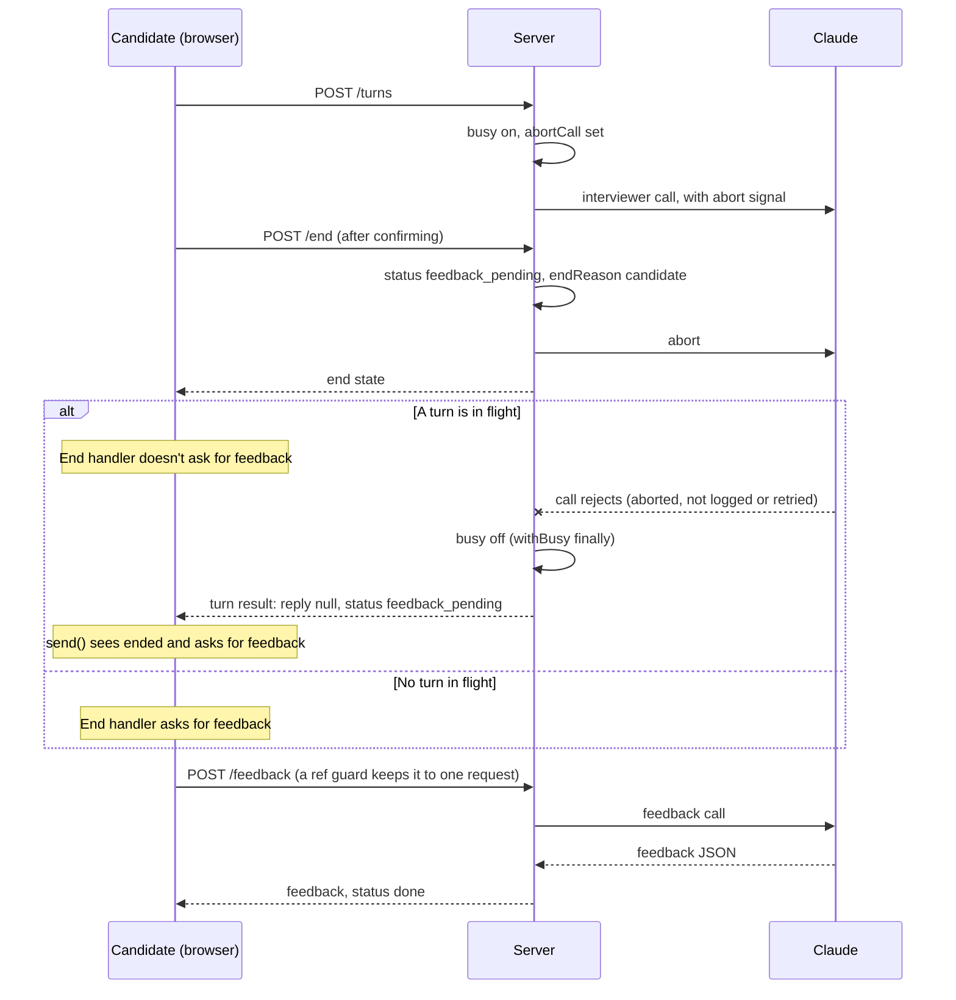
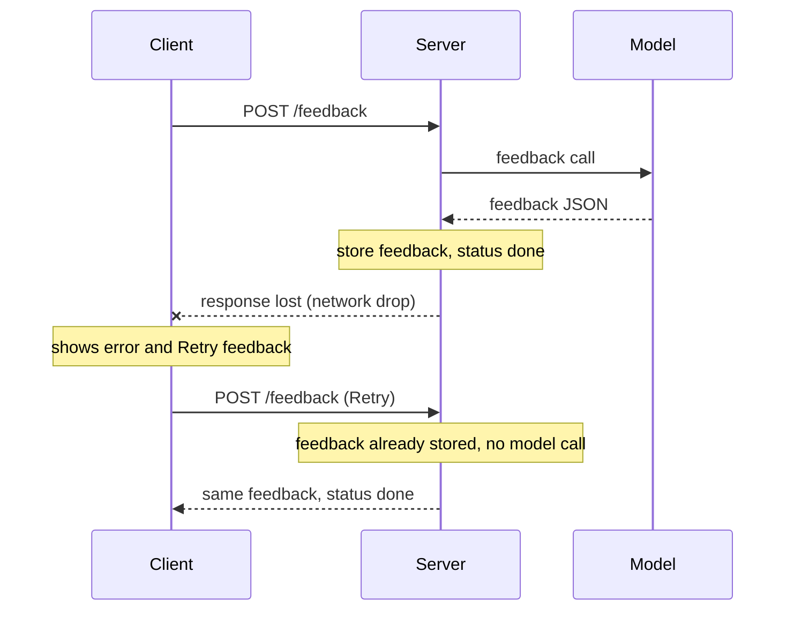

# Session Flow

How one practice session moves from Start to feedback. Rules and values live in [spec.md](spec.md#session-rules); this diagram must match them. Outer states are the server's `SessionStatus` values.

## How the interview ends

Each path sets the session's `endReason`, then feedback runs.

| `endReason` | Trigger |
| --- | --- |
| `candidate` | End interview, confirmed (available anywhere in `active`; a reply in progress is cancelled and dropped) |
| `turn_cap` | Bubo's closing reply to turn 12 finishes |
| `token_cap` | The token check before a call fails |
| `paused_too_long` | 30 minutes in `paused` |
| `interviewer_failed` | An interviewer call fails twice (error, timeout, refusal, or empty reply); the unanswered message stays and counts as a turn |

## Ending mid-reply

End interview while Bubo is replying. Feedback is requested once, by whichever response arrives with nothing still in flight. If End gets 409 `interview_over` (the interview ended another way first), the client treats it as ended the same way. Whichever of the two responses arrives second does nothing more, and a final reply that finished first stays in the transcript.

If the client asked for feedback before the turn result arrived, the server would still be busy and answer 409 `feedback_in_progress`.

## Feedback

- The client asks for feedback as soon as the interview ends. The server makes one feedback call per request.
- Success stores the feedback on the session (in memory, until it expires), moves it to `done`, and returns the feedback. Any failure moves it to `feedback_failed`, where the same request can be made again.
- On `feedback_failed`, `feedback_in_progress`, or no answer at all, the client shows **Retry feedback**. `not_found` (the session expired) can't be fixed by asking again, so there is no button.
- On `feedback_in_progress`, the client first waits 3 seconds and asks once more on its own, with "Writing your feedback…" still showing. Retry feedback appears only if that answer is also a failure or still in progress.
- After 3 failed Retry feedback attempts, a notice suggests a new interview and **Start a new interview** appears next to Retry feedback; it returns to the landing page and drops this session. `feedback_in_progress` doesn't count as a failure.
- A send that gets 409 `interview_over` shows that message as the end notice, marks the message "Not sent", and asks for feedback.

### Retrying safely: the feedback request is idempotent

A request is **idempotent** when sending it twice has the same effect as sending it once. The feedback route gets there by remembering its answer: the first success is stored, and any later request for the same session gets that stored answer back instead of a new model call or an error.

That makes retrying safe even when the client can't tell what happened. Here the response is lost after the server finished, so the client thinks the call failed:

What the server answers depends only on the session, never on how many times it has been asked:

| Session when the request arrives | Answer | Client |
| --- | --- | --- |
| `active` | 409 `feedback_not_ready` | No button |
| Feedback call in flight (`busy`) | 409 `feedback_in_progress` | Asks again once after 3 seconds, then Retry feedback |
| `feedback_pending` or `feedback_failed`, nothing in flight | New feedback call | Shows feedback, or the error and Retry |
| `done` (feedback stored) | 200, the stored feedback | Shows feedback |
| Expired | 404 `not_found` | No button |

The client never has to cancel or coordinate with another request: whichever request arrives after the feedback is stored gets the same answer.

## Timers

| Timer | Runs during | What happens |
| --- | --- | --- |
| Pause check-in | `candidate_turn` | Banners at 5 and 10 minutes; reset on send, restart on resume |
| Pause limit | `paused` | Stated on pause, notice at 25 minutes, interview ends at 30 |
| Idle expiry | Any state | Server drops the session after 30 minutes idle (35 while paused) |

## Turn behavior

The server adds a turn note to every candidate message, with a marker on the turns below; the candidate never sees them. What Bubo does with each marker is written in `persona.md`; [turn-requests.md](turn-requests.md) shows how the two meet.

| Call | Server adds | Bubo's reply |
| --- | --- | --- |
| Opening | Kickoff note | Introduces herself, restates the scenario, invites clarifying questions |
| Turns 1-9 | `[Turn N of 12]` | Interviews, following the scenario's pacing guide |
| Turn 10 | `[Turn 10 of 12]` and the wrap-up marker | Mentions the session is nearly up and steers to a big-picture wrap-up |
| Turn 11 | `[Turn 11 of 12]` | Interviews as usual; the turn-10 wrap-up is already in the conversation |
| Turn 12 | `[Turn 12 of 12]` and the final-turn marker | Closes warmly, asks nothing new; then input locks and feedback starts |
| Early final turn (later) | The final-turn marker, when the token check shows this is the last turn that fits | Same as turn 12 |

## Inside a turn

- `bubo_replying` is the session's `busy` flag. No sends, pause, or second call while it is set.
- See [Turn behavior](#turn-behavior) for what the server adds to each call.
- The transcript is hidden in `paused` and the input is locked in `bubo_replying` and `paused`.

## Leaving

A refresh or tab close ends the session from any state; the browser asks first, from Start until Practice again. The server drops the abandoned session on idle expiry.
