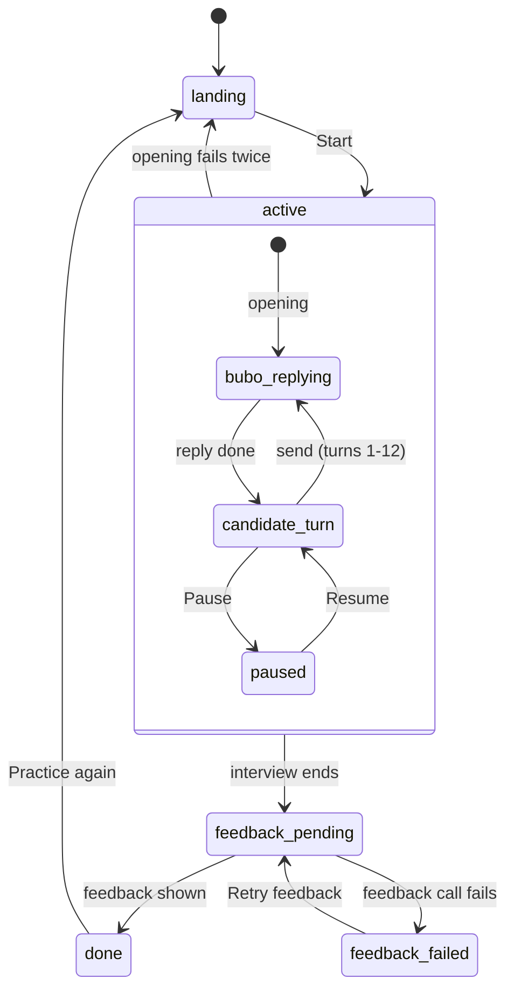

# Session Flow

How one practice session moves from Start to feedback. Rules and values live in [spec.md](spec.md#session-rules); this diagram must match them. Outer states are the server's `SessionStatus` values.

## How the interview ends

Each path sets the session's `endReason`, then feedback runs.

| `endReason` | Trigger |
| --- | --- |
| `candidate` | End interview, confirmed (available anywhere in `active`; a reply in progress is dropped) |
| `turn_cap` | Bubo's closing reply to turn 12 finishes |
| `token_cap` | The token check before a call fails |
| `paused_too_long` | 30 minutes in `paused` |
| `interviewer_failed` | An interviewer call fails twice (error, timeout, refusal, or empty reply); the unanswered message stays and counts as a turn |

## Timers

| Timer | Runs during | What happens |
| --- | --- | --- |
| Pause check-in | `candidate_turn` | Banners at 5 and 10 minutes; reset on send, restart on resume |
| Pause limit | `paused` | Stated on pause, notice at 25 minutes, interview ends at 30 |
| Idle expiry | Any state | Server drops the session after 30 minutes idle (35 while paused) |

## Turn behavior

The server adds a turn note to every candidate message, with a marker on the turns below; the candidate never sees them. What Bubo does with each marker is written in `persona.md`; [turn-requests.md](turn-requests.md) shows how the two meet.

| Call | Server adds | Bubo's reply |
| --- | --- | --- |
| Opening | Kickoff note | Introduces herself, restates the scenario, invites clarifying questions |
| Turns 1-9 | `[Turn N of 12]` | Interviews, following the scenario's pacing guide |
| Turn 10 | `[Turn 10 of 12]` and the wrap-up marker | Mentions the session is nearly up and steers to a big-picture wrap-up |
| Turn 11 | `[Turn 11 of 12]` | Interviews as usual; the turn-10 wrap-up is already in the conversation |
| Turn 12 | `[Turn 12 of 12]` and the final-turn marker | Closes warmly, asks nothing new; then input locks and feedback starts |
| Early final turn (later) | The final-turn marker, when the token check shows this is the last turn that fits | Same as turn 12 |

## Inside a turn

- `bubo_replying` is the session's `busy` flag. No sends, pause, or second call while it is set.
- See [Turn behavior](#turn-behavior) for what the server adds to each call.
- The transcript is hidden in `paused` and the input is locked in `bubo_replying` and `paused`.

## Leaving

A refresh or tab close ends the session from any state; the browser asks first, from Start until Practice again. The server drops the abandoned session on idle expiry.
