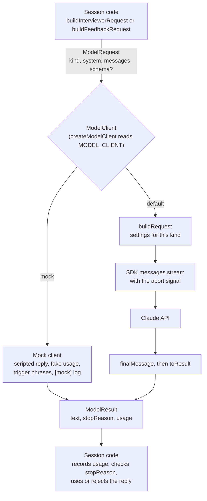

# Model Calls

How session code talks to Claude. Code is in `source/server/model/`; settings are in `source/server/config.ts`.

Session code never touches the SDK. It builds a `ModelRequest` (which call it is, the system prompt, the messages, and an optional JSON schema) and hands it to a `ModelClient`. The real client turns that into one Anthropic API call. The mock, used in tests and in `MODEL_CLIENT=mock` dev mode, returns a scripted reply instead. Either way the session gets back the same `ModelResult`: the reply text, why it stopped, and the token usage.

## What buildRequest sets

| Setting | Interviewer call | Feedback call | Why |
| --- | --- | --- | --- |
| `max_tokens` | 400 | 1,500 | Spec limits; values in `config.ts` |
| Effort | `low` | `medium` | Short conversational turns vs. analytical grading |
| Thinking | Off | Off | Thinking counts against `max_tokens` and could crowd out the reply |
| Output format | Plain text | JSON matching `FEEDBACK_SCHEMA` | Set only when the request has a `schema` |
| Caching | Automatic | Automatic | Reuses the cached system prompt and earlier turns |

Every call uses the one model ID in `config.ts`. No sampling parameters are sent; the model rejects them.

## Rules this relies on

- `kind` is the only thing that picks per-call settings. A new kind of call needs a row in `SETTINGS` in `anthropic.ts`.
- SDK retries are off. The session decides whether to retry (interviewer: once; feedback: no, the candidate retries).
- Refusals are normal results, not errors. The session treats them as a failed reply.
- Aborting the signal (End Interview mid-reply) makes the call reject. Its usage never arrives, so it isn't counted.
- Logs never include message text, since API errors can quote it.
- Session code logs one `[usage]` line per call that returns usage (`recordUsage` in `session/calls.ts`): session ID, which call, token counts by kind, stop reason, and the call's and session's estimated cost from `PRICE_PER_MTOK` in `config.ts`. Aborted and errored calls have no usage, so they don't log one. The estimate is for spotting trends; the Console's usage page is the real bill.
