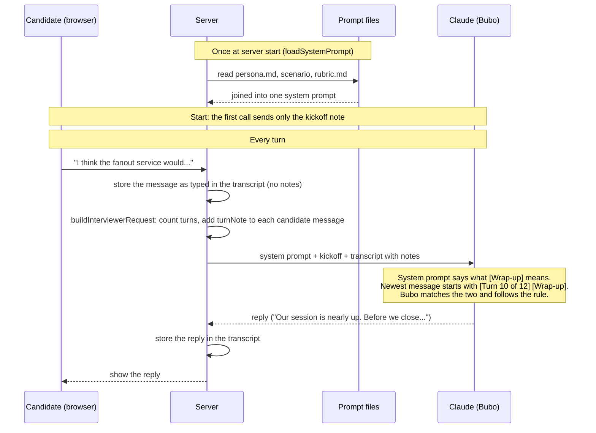

# Turn Requests

How one candidate turn becomes a model call, and how the server's turn markers connect to the rules in `persona.md`. Which turn gets which marker is in the [Turn behavior](flow.md#turn-behavior) table; code is in `source/server/session/request.ts`.

## One turn, start to finish



## What Claude receives at turn 10

```text
SYSTEM (cached, same every call)
  persona.md   ...
               - [Wrap-up]: say that our session is nearly up...   <-- the rule
               - [Final turn]: close warmly...
  scenario     ...
  rubric.md    ...

MESSAGES (rebuilt from the transcript every call)
  user       [The candidate pressed Start. Open the interview.]     <-- kickoff
  assistant  Hoo, hello. I'm Bubo...
  user       [Turn 1 of 12]

             Who sends notifications?
  assistant  ...
  ...
  user       [Turn 10 of 12] [Wrap-up]                               <-- the marker

             I think the fanout service would...
```

## Rules this relies on

- No code links a marker to its rule. The marker string in `request.ts` and the bullet in `persona.md` must match exactly.
- The transcript stores messages as typed. Notes and markers are added each time a request is built.
- Markers depend only on the turn number and the session's `wrapUpTurn` and `finalTurn` (turns 10 and 12 unless the token check moves one to the newest turn). A turn already sent never changes: at turn 11, turn 10 still carries `[Wrap-up]`, so the cached prefix is unchanged.
- The persona's "Markers" rule tells Bubo to act only on a marker in the newest message, so she doesn't warn twice.
